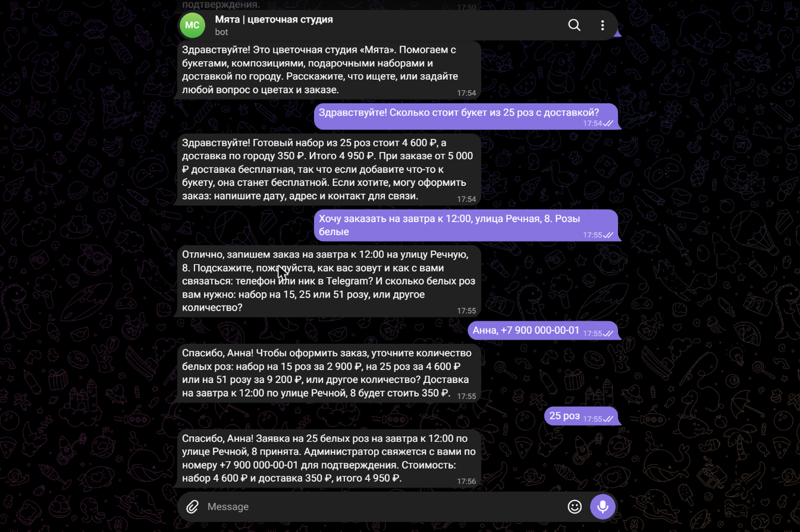
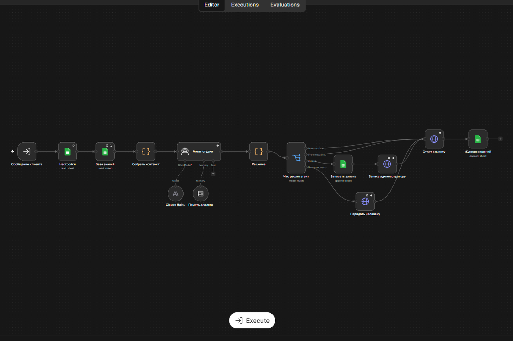

# ИИ агент для небольшого бизнеса на n8n и Claude

Агент принимает сообщения клиентов в Telegram, отвечает по базе знаний, собирает заявки в Google таблицу и раз в день присылает владельцу отчёт. На каждое сообщение он сам выбирает действие и записывает в журнал, что выбрал и почему.

Это мой собственный проект, а не работа для заказчика. Цветочная студия «Мята», её цены, клиенты и телефоны вымышлены. Система при этом рабочая: все сценарии ниже прогнаны на живом боте.

## Что умеет агент

| Действие | Когда выбирает |
|---|---|
| Ответ по базе | Ответ есть в базе знаний |
| Уточняющий вопрос | Не хватает данных, чтобы ответить или оформить заявку |
| Заявка | Известны имя, запрос и контакт. Строка пишется в таблицу, администратору уходит сообщение |
| Передача человеку | Вопрос вне базы, жалоба, нестандартный заказ, просьба позвать человека |

Цен и условий, которых нет в базе знаний, агент не называет. Если не знает, говорит об этом и передаёт вопрос человеку.

Каждый вечер в 20:00 по Москве второй сценарий собирает данные за день: сколько диалогов и заявок, сколько раз понадобился человек, какие вопросы повторяются и что стоит добавить в базу знаний. Тот же отчёт приходит по команде `/otchet` в группе администратора.

## Как устроено

- **n8n** в Docker, три сценария: приём сообщений, агент, отчёт за день.
- **Claude Haiku** через API. Модель возвращает решение в виде JSON: действие, ответ клиенту, причина, тема, пункты базы.
- **Google Таблицы**: база знаний, заявки, журнал решений, отчёты, настройки.
- **Telegram**: сообщения забираются опросом `getUpdates`, внешний адрес и вебхук не нужны.
- **Память диалога** по идентификатору чата, команда `/start` начинает новый диалог.

База знаний из 40 пунктов целиком подставляется в инструкцию агента, векторная база для такого объёма не нужна.

## Проверка

15 сценариев на живом боте: обычные вопросы, расчёт суммы, заявка с нехваткой данных, жалоба, вопрос вне базы, попытка выбить несуществующую цену, давление ради скидки, просьба позвать человека, сообщение не по теме, попытка сменить роль агента. В чистовом прогоне все 15 дали ожидаемое действие.

По ходу проверки найдено и исправлено шесть недочётов. Таблица, список недочётов и то, что проверкой не покрыто: [docs/proverka_15_scenariev.md](docs/proverka_15_scenariev.md).

## Что в репозитории

| Путь | Что там |
|---|---|
| `workflows/` | Экспорт трёх сценариев n8n без секретов и идентификаторов |
| `tools/build_workflows.js` | Сборка сценариев из одного файла, там же инструкция агента |
| `tools/deploy.ps1` | Выкладка сценариев в локальный n8n |
| `knowledge/baza_znaniy.md` | База знаний студии |
| `docs/instrukciya_vladelcu.md` | Инструкция для владельца бизнеса |
| `docs/proverka_15_scenariev.md` | Таблица проверки |
| `materials/` | Скриншоты и видео |

## Как запустить у себя

1. Скопируйте `.env.example` в `.env` и вставьте токен бота от BotFather.
2. Поднимите n8n: `docker compose up -d`, откройте http://localhost:5678 и создайте учётную запись.
3. Создайте Google таблицу с листами «Заявки», «Журнал решений», «Отчёты», «База знаний», «Настройки». Заголовки столбцов перечислены в `tools/build_workflows.js`, базу знаний возьмите из `knowledge/baza_znaniy.md`.
4. В n8n добавьте учётные данные Anthropic и Google Sheets OAuth2.
5. Импортируйте файлы из `workflows/`, в узлах Google Sheets укажите свою таблицу, в узлах модели и таблиц выберите свои учётные данные.
6. Добавьте бота в группу администратора, напишите там `/chatid` и вставьте полученный номер в лист «Настройки».
7. Опубликуйте все три сценария.

## Ограничения

- Память диалога хранится в памяти процесса n8n и сбрасывается при его перезапуске.
- Фото и голосовые сообщения агент не читает.
- Опрос Telegram идёт раз в 5 секунд, ответ клиенту приходит примерно через 8–15 секунд.
- Проверка шла с одного аккаунта Telegram, работа с несколькими клиентами одновременно не испытывалась.

## Материалы

Скриншоты сервиса: [materials/skrinshoty](materials/skrinshoty). Версии с подписями: [materials/s_podpisyami](materials/s_podpisyami). Видео собрано из последовательных снимков экрана живого диалога, это не непрерывная запись: [materials/myata_agent_video.mp4](materials/myata_agent_video.mp4).
